# Experiment Log

Log every run here, even failed/partial ones — the panel and your supervisor will want to see
iteration, not just final numbers. One entry per run.
Figures are embedded under the run that produced them, each with how to read it and what
it shows (view in the Markdown preview or on GitHub).

## Template (copy for each new run)

### Run: YYYY-MM-DD-N

- **Condition:** reactive-baseline | vanilla-prophet | enhanced-prophet
- **Traffic pattern:** steady | spiky | seasonal
- **Enhancement layers active (if enhanced-prophet):** regressors / confidence-bound / z-score / adaptive-retrain
- **Data source:** synthetic | real CloudWatch+Locust
- **Duration / sample size:**
- **Results:**
  - P95 latency:
  - P99 latency:
  - Cold start count:
  - Cost per request:
- **Notes / anomalies:**
- **Next step:**

---

## Known issues

Open problems that affect the validity of results. Update the status when one is
resolved; details are in the run entries named.

| # | Issue | First seen | Status / mitigation |
|---|---|---|---|
| 1 | Laptop load generator throttled on battery with the display off: throughput capped at about 45 req/s regardless of users | 2026-10-10-3 | Resolved: Locust and the controller now run on EC2 (`loadgen/`, c7i-flex.large in ap-south-1); validated in 2026-10-16-1 |
| 2 | Single-process Locust saturates at high load (5x users gave 3.6x throughput; client P95 up while billed time flat) | 2026-10-04-1 | Partly mitigated: EC2 client delivers 98.4-100.2% of design per minute up to 40 users (400 req/s, 2026-10-18-5), P95 flat at 45 ms. Still to check at spiky peak (100 users, about 1,000 req/s) |
| 3 | Network conditions vary between sessions (131 vs 225 req/s at 20 users) | 2026-10-06-1 | Resolved: same-region EC2 client plus `USER_RPS` (fixed requests per second per user) makes the load independent of latency. Still run conditions back-to-back |
| 4 | Sandbox stack missing at run time (destroyed between sessions), so every request failed | 2026-10-04-1, 2026-10-10-3 | Mitigated: keep the function deployed (idle cost is zero); invoke once and check Locust `# fails` = 0 before each run |
| 5 | `sandbox_user.py` appends to the invoke log, mixing runs in one file | 2026-10-04-1 | Mitigated: unique `SANDBOX_INVOKE_LOG` per run |
| 6 | `cold_start` flag counts environment inits, not user-visible cold starts (proactive initialisation hides most) | 2026-10-06-1 | Open. Decide the metric: report both, with a latency threshold (e.g. > 1 s) for user-visible |
| 7 | Capacity calibration evaluated in-sample, on a falling segment only | 2026-10-10-2 | Partly mitigated (2026-10-29-1): pooled fit on EC2 runs 1 + 2 (80-400 req/s) with a multiplicative margin; leave-one-run-out shows no margin fixes extrapolation, so the calibration data must cover the experiment's load range. Held-out run 3 (2026-10-29-5): live decisions 0/29 under (old calibration 6/29) at +17% env-minutes, but concurrency per req/s drifts upward between sessions (17% of minutes above the margin). Candidate fix: recalibrate online from the live 60-minute window |
| 8 | `concurrency` as a Layer 1 regressor leaks future data unless lagged | 2026-10-06-1 | Open. Use lagged concurrency only |
| 9 | `TrafficPatternShape` spikes can overlap and merge at high `SPIKES_PER_HOUR` | 2026-10-04-1 | Open. Document in the method or enforce non-overlapping spikes |
| 10 | Controller trained on data from before the run (an earlier session plus zero-filled gap inside the fetch lookback) | 2026-10-16-2 | Resolved: `--history-start`, set by `run_experiment.sh` to the run's first full minute; confirmed live in 2026-10-18-5 (first decision at minute 64) |
| 11 | Seasonal traffic from EC2 is a near-exact repeating sine (fixed per-user rate, no noise), so a trivial seasonal-naive forecast beats Prophet 3x; the forecasting comparison is too easy to be meaningful | 2026-10-18-2 | Mitigated: seeded noise and drift in `TrafficPatternShape` (`traffic_realism` in the config); Prophet skill over seasonal naive +0.22 in simulation (2026-10-18-3) and +0.21 live (2026-10-18-5). Real Azure Functions trace planned before the thesis |
| 12 | Start state not controlled: a run started minutes after earlier traffic finds environments already warm, so it has no start-up cold starts (0 in 2026-10-18-5 vs 20 in 2026-10-16-2) | 2026-10-18-5 | Fixed (2026-10-30-1): `run_experiment.sh` publishes a fresh Lambda version and moves alias `prod` to it before every run, so no environment is warm; the version is recorded in each meta file (`lambda_version`, `start_state`). Validation run: 23 cold starts, all in the first 10 s, none after. Seen again in 2026-10-29-5 |
| 13 | A run started on stale code after `git pull` failed on the instance | 2026-10-18-4 | Resolved: `run_experiment.sh` refuses to start unless HEAD equals `origin/main` |

## Runs

### Run: 2026-09-07-1
- Condition: vanilla-prophet
- Traffic pattern: steady, spiky, seasonal (synthetic)
- Data source: synthetic
- Notes: initial Prophet fit via `prophet_starter.py`. Spiky pattern produced wide,
  negative-floored confidence intervals — concretely motivates the confidence-bound
  trigger layer (layer 2) in the enhanced framework.
- Next step: pull real CloudWatch/Locust data, replace synthetic generator.

### Run: 2026-09-16-1
- Condition: enhanced-prophet
- Traffic pattern: spiky (synthetic)
- Enhancement layers active (if enhanced-prophet): confidence-bound / z-score
- Data source: synthetic
- Duration / sample size: 150 holdout points
- Results:
  - Point-forecast capacity total: 300
  - Confidence-bound capacity total: 1057 (+252.3% vs point forecast)
  - Enhanced capacity total: 1122 (+274.0% vs point forecast)
  - Negative lower-bound forecasts: 100.0% of points
  - Layer 2 activations: 126 / 150 decisions
  - Layer 3 overrides: 24 / 150 decisions
- Notes / anomalies: The demo completed without errors and saved
  `testing/layer_validation/results/layer_comparison_spiky.png`. This synthetic demo does not measure P95/P99
  latency, cold starts, or cost per request.
- Figure:

  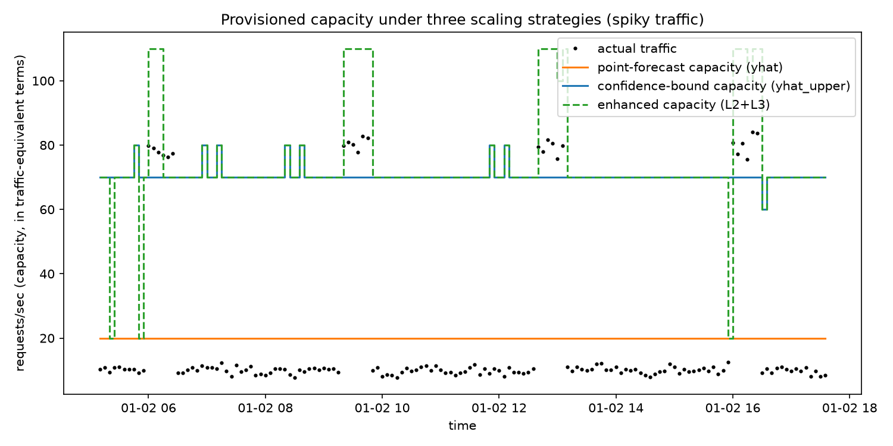

  *Provisioned capacity (in requests/s) for point-forecast (orange), confidence-bound
  (blue) and Layer 2+3 (green dashed) scaling; black dots are actual traffic.*
  - How to read it: a line above the dots is spare capacity (cost); a dot above
    the line is unserved demand (cold starts).
  - What it shows: `yhat` (orange) sits at about 20 req/s, so every spike at about
    80 req/s is unserved. `yhat_upper` (blue) covers 70 req/s all the time, which
    is 7x the normal load. Layer 3 (green) jumps to about 110 when a spike is
    detected, but only after it has started. The blue line sits under the green
    one wherever the two agree. Synthetic data only.
- Next step: validate the layers against real CloudWatch/Locust data.

### Run: 2026-09-16-2
- Condition: vanilla-prophet
- Traffic pattern: steady, spiky, seasonal (synthetic)
- Data source: synthetic
- Duration / sample size: 48 hours per pattern, 576 points per pattern at 5-minute intervals
- Results:
  - Generated `steady_traffic.csv`, `spiky_traffic.csv`, and `seasonal_traffic.csv`
    under `testing/pattern_exploration/data/processed/`.
  - Prophet forecast plots generated for all three traffic patterns under
    `testing/pattern_exploration/results/`.
- Notes / anomalies: This run prepares reproducible local input data and visual
  forecast outputs. It does not measure P95/P99 latency, cold starts, or cost per
  request.
- Figure:

  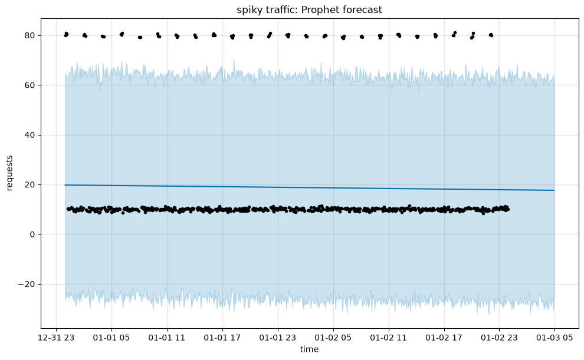

  *Vanilla Prophet fit on 48 h of synthetic spiky traffic. Black dots are
  observations, the line is `yhat`, the shaded band is the 95% interval.*
  (`steady_forecast.png` and `seasonal_forecast.png` in the same folder.)
  - What it shows: Prophet cannot place short random spikes in time, so it
    averages them: `yhat` (about 20) sits above the normal level (about 10)
    and far below the spikes (about 80), and the band spans -25 to 65. A
    negative lower bound is meaningless for a request count. This is the
    motivation for Layer 3 (detect spikes rather than forecast them).
- Next step: use the generated data as the common input for the three scaling
  conditions before moving to real CloudWatch/Locust data.

### Run: 2026-09-16-3
- Condition: enhanced-prophet
- Traffic pattern: spiky (synthetic)
- Enhancement layers active (if enhanced-prophet): confidence-bound / z-score
- Data source: synthetic
- Duration / sample size: 150 holdout points
- Results:
  - Point-forecast capacity total: 300
  - Confidence-bound capacity total: 1052 (+250.7% vs point forecast)
  - Enhanced capacity total: 1120 (+273.3% vs point forecast)
  - Negative lower-bound forecasts: 100.0% of points
  - Layer 2 activations: 126 / 150 decisions
  - Layer 3 overrides: 24 / 150 decisions
- Notes / anomalies: A rerun of the demo completed successfully and saved
  `testing/layer_validation/results/layer_comparison_spiky.png`. Capacity totals vary slightly between Prophet
  runs because of numerical variation in Stan fitting. This synthetic demo does
  not measure P95/P99 latency, cold starts, or cost per request.
- Next step: validate cold-start and latency impact using the same workloads on
  the real Lambda application.

### Run: 2026-09-16-4
- Condition: vanilla-prophet and enhanced-prophet local validation
- Traffic pattern: steady, spiky, seasonal for pattern exploration; spiky for
  layer validation
- Enhancement layers active (if enhanced-prophet): confidence-bound / z-score
- Data source: synthetic
- Duration / sample size: 576 points per traffic pattern; 150 holdout points for
  the Layer 2/3 demo
- Results:
  - Reorganized local testing into `testing/pattern_exploration/` for vanilla
    Prophet behavior and `testing/layer_validation/` for enhancement-layer
    validation.
  - Moved generated CSV inputs and forecast plots into the corresponding testing
    environment directories.
  - Updated both scripts to resolve imports and output paths from their own file
    locations, so they run from the repository root.
  - Pattern exploration completed for all three traffic shapes.
  - Layer validation completed successfully with 100.0% negative lower bounds,
    126 Layer 2 activations, and 24 Layer 3 overrides.
- Notes / anomalies: The local validation measures forecast and capacity behavior
  only. It does not yet measure AWS Lambda P95/P99 latency, cold starts, or cost
  per request.
- Next step: run the same separated workflows against real CloudWatch/Locust
  data and connect the validated controller to Lambda Provisioned Concurrency.

### Run: 2026-09-28-1
- Condition: reactive-baseline
- Traffic pattern: steady
- Data source: sandbox Lambda via signed boto3 Invoke and Locust
- Duration / sample size: default steady shape, 9,611 successful requests
- Results:
  - P95 latency: 165.15 ms
  - P99 latency: 273.21 ms
  - Cold start count: 17
  - Cost per request: approximately $2.2e-7
- Notes / anomalies: The per-request source log is stored in
  `results/reactive_baseline_steady_log.jsonl`, with the canonical summary in
  `results/reactive-baseline_steady.json`. Latency includes signed boto3 and
  network overhead. This is a sandbox pipeline measurement, not a final
  `snip-infra` or Function URL result. The baseline runner now supports steady,
  spiky, and seasonal shapes; only steady has been run and recorded here.
- Next step: run the same baseline for spiky and seasonal traffic, then repeat
  the workloads with vanilla and enhanced Prophet control.

### Run: 2026-09-28-2
- Condition: infrastructure measurement
- Traffic pattern: not applicable
- Data source: sandbox Lambda Provisioned Concurrency API
- Duration / sample size: three allocation changes on alias `prod` in `ap-south-1`
- Results:
  - 0 -> 2 provisioned instances: 84.3 seconds
  - 2 -> 5 provisioned instances: 84.4 seconds
  - 5 -> 2 provisioned instances: 12.5 seconds
  - All changes reached `READY`
- Notes / anomalies: `measure_pc_lag.py` removes the Provisioned Concurrency
  configuration in a `finally` block. These samples support the configured
  `forecasting.lead_time_minutes: 10`, but they are limited to this sandbox and
  these capacity values; more repetitions are needed for a robust lag
  distribution.
- Next step: collect repeated lag measurements and include Provisioned
  Concurrency cost in the proactive-condition comparison.

### Run: 2026-10-04-1
- Condition: reactive-baseline (smoke test of the new traffic-pattern harness;
  no Provisioned Concurrency)
- Traffic pattern: spiky (`TrafficPatternShape`, `SEED=42`, `BASE_USERS=20`,
  `SPIKES_PER_HOUR=24`, `DURATION_S=300`)
- Data source: sandbox Lambda via signed boto3 Invoke and Locust
  (`sandbox_locustfile_patterns.py`, same `LambdaInvokeUser` as 2026-09-28-1)
- Duration / sample size: 300 s (12:30:32-12:35:32 +05:30), 83,863 successful
  requests, 0 errors
- Results:
  - P95 latency: 340 ms
  - P99 latency: 561 ms
  - Cold start count: 93 (0.11%); 19 at start-up, 74 at spike onset, all within
    the first 57 s; cold-start latency 2.6-3.7 s (median 3.16 s)
  - Cost per request: approximately $2.2e-7 (mean billed duration 9 ms, 128 MB)
  - Per phase:

    | Phase | Users | req/s | P95 | P99 | Cold starts |
    |---|---|---|---|---|---|
    | Pre-spike (0-49.5 s) | 20 | 131 | 241 ms | 392 ms | 19 |
    | Spike (49.5-176.6 s) | 100 | 476 | 360 ms | 616 ms | 74 |
    | Post-spike (176.6-300 s) | 20 | 137 | 250 ms | 372 ms | 0 |
- Notes / anomalies:
  - Raw log: `data/raw/smoke_spiky.jsonl` (gitignored). It also contains 16,420
    rows from an earlier failed attempt (12:26:55-12:27:58, all
    `ResourceNotFoundException: Function not found`), because `sandbox_user.py`
    appends to the log. Those rows are excluded from the figures above.
  - The two seeded spikes (49.5-122.9 s and 115.1-176.6 s) overlapped and merged
    into one 127 s spike. Likely only at a high `SPIKES_PER_HOUR` relative to
    `DURATION_S`.
  - Possible load-generator bottleneck: 5x users gave only 3.6x throughput, and
    response P95 rose 241 -> 360 ms while billed duration P95 stayed at
    15-16 ms. The added tail latency is outside Lambda (client CPU or network),
    so single-process Locust may confound spike tail latency.
  - 19 (not 20) start-up cold starts because a manual `aws lambda invoke` just
    before the run had already warmed one environment.
- Next step: use a unique `SANDBOX_INVOKE_LOG` per run; re-run with
  `--processes 4` (or fewer users) to check whether spike P95 drops back toward
  the pre-spike level; decide whether `TrafficPatternShape` replaces the shapes
  in `shapes.py` for all nine scenarios.

### Run: 2026-10-06-1
- Condition: reactive-baseline (Prophet training-data collection; no
  Provisioned Concurrency, confirmed empty with
  `list-provisioned-concurrency-configs` before the run)
- Traffic pattern: seasonal (`TrafficPatternShape`, `SEED=42`, `BASE_USERS=20`,
  amplitude +/-60% so 8-32 users, `SEASON_PERIOD_S=1800`, `DURATION_S=5400`)
- Data source: sandbox Lambda via signed boto3 Invoke and Locust
  (`sandbox_locustfile_patterns.py`, single process), plus CloudWatch via
  `cloudwatch_fetch.py`
- Duration / sample size: 5400 s, 2026-10-06 22:58:51 -> 2026-10-07 00:28:51
  +05:30 (17:28:51 -> 18:58:51 UTC), 1,123,469 requests, 0 errors
- Results:
  - P95 latency: 122 ms (P50 92 ms, P99.9 260 ms, max 3.63 s)
  - P99 latency: 156 ms
  - Cold start count: 51 (`cold_start: true`; 0.0045%), 20 at start-up and 31
    during the run
  - Cost per request: approximately $2.1e-7 (mean billed duration 5.4 ms, 128 MB)
  - Per-minute invocations by cycle:

    | Cycle | Mean /min | Peak /min (minute) | Trough /min (minute) |
    |---|---|---|---|
    | 1 | 12,347 | 19,389 (6) | 5,286 (22) |
    | 2 | 12,454 | 19,416 (36) | 5,336 (52) |
    | 3 | 12,644 | 19,981 (67) | 5,400 (82) |
- Notes / anomalies:
  - Files: raw log `data/raw/20261006-2258_seasonal_train.jsonl`; CloudWatch
    export `data/raw/seasonal_train_run1.csv` (91 rows, `--minutes 100`);
    trimmed Prophet input `data/processed/seasonal_train_run1.csv` (89 full
    minutes, 17:29 -> 18:57 UTC, partial first and last minutes dropped). All
    gitignored. `ds` is tz-naive UTC.
  - CloudWatch validation: total invocations 1,123,550 (CloudWatch) vs
    1,123,469 (Locust), +81 (0.007%), probably manual CLI invokes. Per full
    minute the difference is -0.19% to +0.18% (minute-boundary timing), so
    CloudWatch `Invocations` is a valid target series for Prophet.
  - No load-generator bottleneck: throughput stayed at about 10-11 req/s per
    user from 8 to 32 users (peak about 327 req/s), P95 109-138 ms at every user
    level, billed P95 15-16 ms throughout.
  - Cold starts recur on each rising slope (about 464-571 s, 1535-1994 s,
    3380-3935 s, 5248-5380 s): environments reclaimed in the trough are
    re-created on the next rise. This is a periodic, forecastable cold-start
    cost.
  - Only 5 of the 31 mid-run cold starts were visible to the client (3142,
    2087, 1774, 1009, 460 ms); the other 26 returned in 70-180 ms despite a
    billed duration of about 3.1 s. Likely Lambda proactive initialisation
    (init runs before the request arrives, init time billed to the first
    invoke). The 20 start-up cold starts all waited about 3.6 s. The
    `cold_start` flag therefore counts environment inits, not user-visible
    cold starts.
  - Throughput per user was higher than in 2026-10-04-1 (about 225 vs 131
    req/s at 20 users), so network/client conditions vary between sessions.
  - Regressors: `concurrency` correlates 0.954 with `y` and is not known in
    advance, so it can only be used lagged (leakage risk); `duration_ms` is
    nearly flat (3.7-5.6 ms).
- Next step: fit vanilla Prophet (C2) on the trimmed file with a custom
  30-minute seasonality (built-in daily/weekly off) and a rolling 10-minute-ahead
  forecast; define the cold-start metric as both inits and user-visible cold
  starts (e.g. latency > 1 s); run C1/C2/C3 for a pattern back-to-back in one
  session; add `--csv`/`--html` to future Locust runs.

### Run: 2026-10-10-1
- Condition: vanilla-prophet (offline rolling-origin forecast evaluation; no AWS
  calls, no scaling actions)
- Traffic pattern: seasonal
- Data source: real CloudWatch+Locust (`data/processed/seasonal_train_run1.csv`
  from Run 2026-10-06-1, 89 full minutes)
- Duration / sample size: 20 forecast origins (18:38 -> 18:57 UTC) x 10 horizon
  steps = 200 forecasts
- Configuration (`configs/experiment_config.yaml`):
  - Training window W = 60 min (two full cycles), horizon H = 10 min
    (`lead_time_minutes`), step S = 1 min
  - Custom seasonality: period 30 min, Fourier order 3; built-in
    daily/weekly/yearly seasonality off; interval width 0.95; seed 42
  - At origin t the model is fitted on [t - W, t) only, so no future data leaks
    into training
- Results:
  - P95 / P99 latency, cold starts, cost: not applicable (forecast accuracy only)

    | Horizon | MAE (invocations/min) | MAPE | 95% interval coverage |
    |---|---|---|---|
    | 1 min | 355 | 2.23% | 95% |
    | 2-4 min | 371-389 | 2.40-2.58% | 90% |
    | 5 min | 207 | 1.65% | 95% |
    | 6-9 min | 144-161 | 1.45-1.50% | 95-100% |
    | 10 min | 176 | 1.59% | 95% |
  - Negative `yhat_lower`: 0% (vs about 100% on synthetic spiky data,
    Run 2026-09-07-1)
  - Mean interval width about 1,720-1,740 invocations/min at every horizon
- Notes / anomalies:
  - Outputs: `results/rolling_forecast/seasonal_train_run1_forecasts.csv`,
    `_summary.json`, `_forecast.png`. Reproducible: two runs gave
    byte-identical CSVs.
  - Error is higher at h = 1-4 than h = 5-10. This is not a real horizon effect:
    all 20 origins sit on one descending segment, so short-horizon targets fall
    on the steep drop just after the 18:36 peak. Too few origins to infer a
    horizon trend.
  - Near-best case for Prophet: near-sinusoidal traffic with a known period.
  - Small dips in actual traffic at about 17:58 and 18:32 UTC (e.g. 14,600 vs
    about 16,000 expected), probably client-side; candidates for testing the
    Layer 3 Z-score detector.
  - `aws.function_name` in the config changed from `snip-infra-handler` to
    `sandbox-lambda`.
- Figure:

  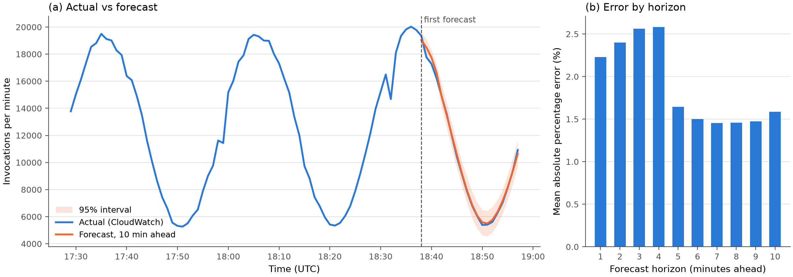

  *(a) Actual invocations per minute (blue) and the 10-minute-ahead forecast
  (orange, 95% band shaded) from each origin. (b) Mean absolute percentage
  error by forecast horizon.*
  - How to read it: forecasts start at the dashed line, once 60 minutes of
    history exist. Each orange point was made 10 minutes before that time,
    using only earlier data.
  - What it shows: the forecast follows the falling and rising slope within
    about 2%, and the actual line stays inside the band. The higher error at
    1-4 minutes comes from the steep drop just after the peak, not a real
    horizon effect (see notes).
- Next step: collect a longer seasonal training run (e.g. 3 h) for more origins
  across all phases of the cycle; convert forecasts to a Provisioned
  Concurrency target using the measured concurrency-vs-rate relationship.

### Run: 2026-10-10-2
- Condition: vanilla-prophet vs enhanced-prophet Layer 2 (offline capacity
  replay; no AWS calls, no scaling actions)
- Traffic pattern: seasonal
- Enhancement layers active (if enhanced-prophet): confidence-bound only
- Data source: real CloudWatch+Locust (`data/processed/seasonal_train_run1.csv`)
  and the 10-minute-ahead forecasts from Run 2026-10-10-1
- Duration / sample size: calibration on 89 minutes; replay on 20 minutes
  (18:38 -> 18:57 UTC)
- Configuration:
  - Conversion (`src/controller/capacity_model.py`):
    target = ceil(intercept + slope x req/s + headroom), with req/s =
    forecast invocations per minute / 60
  - Fitted: intercept 3.91, slope 0.0550 per req/s (about 1 environment per
    18 req/s), R^2 0.910; headroom 1.68 = 95th percentile of fit residuals
    (`capacity.calibration_quantile: 0.95`)
  - C2 feeds `yhat`, C3 feeds `yhat_upper` through the identical conversion
- Results:
  - P95 / P99 latency, cold starts, cost per request: not applicable (offline)

    | Target | Under-provisioned minutes | Env-minutes | Excess env-minutes |
    |---|---|---|---|
    | C2 (`yhat`) | 0 / 20 | 316 | 54 (mean +2.7 per minute) |
    | C3 (`yhat_upper`) | 0 / 20 | 332 | 70 (mean +3.5 per minute) |
    | Perfect forecast (actual rate) | 0 / 20 | 315 | 53 |
- Notes / anomalies:
  - Little's law (rate x billed duration) predicts about 1 concurrent
    environment, but CloudWatch measured 7-28, so an empirical calibration is
    used instead of an assumed formula.
  - With the 10% AWS buffer on top of the headroom (first pass), excess was 84
    (C2) / 102 (C3) env-minutes, about 30% over even with a perfect forecast.
    `aws.pc_buffer_percent` changed 10 -> 0: the measured headroom replaces the
    rule of thumb.
  - C2 is within one env-minute of a perfect forecast; C3 adds about 5%
    capacity with no under-provisioning to prevent on this segment.
  - Falling-traffic minutes sit below the fit line: concurrency may drop faster
    than request rate on the way down (possible hysteresis; not yet tested).
  - In-sample (calibrated and evaluated on the same run) and only covers a
    falling segment, so it cannot show under-provisioning on a rise.
  - Outputs: `results/capacity_calibration/seasonal_train_run1.json`,
    `_replay.csv`, `_calibration.png`.
- Figure:

  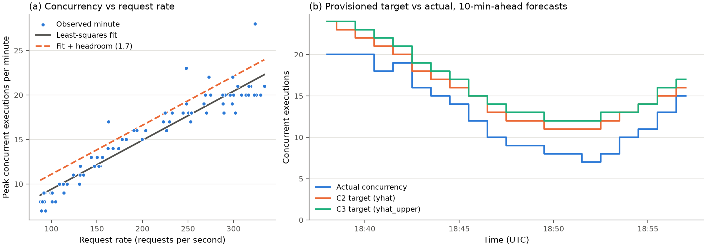

  *(a) Peak concurrency per minute against request rate, with the least-squares
  line and line + headroom. (b) What C2 (`yhat`) and C3 (`yhat_upper`) would have
  provisioned from 10-minute-ahead forecasts, against actual concurrency.*
  - How to read it: (a) is the conversion rule: read a forecast rate on the x
    axis and go up to the dashed line to get the target. In (b), target above
    actual = no cold starts but extra cost.
  - What it shows: concurrency rises almost linearly with load (R^2 0.91), so a
    measured rule replaces Little's law, which predicts about 1. Both targets
    stay above actual in all 20 minutes; C3 is one environment above C2 most of
    the time. In-sample and on a falling segment only.
- Next step: 3-hour seasonal training run plus a separate evaluation run, so
  calibration and replay are out-of-sample and cover rising slopes.

### Run: 2026-10-10-3 (FAILED: load generator throttled)
- Condition: vanilla-prophet, live dry run (`live_controller.py`, no `--apply`;
  decisions computed, Provisioned Concurrency never changed)
- Traffic pattern: seasonal (`TrafficPatternShape`, `SEED=42`, `DURATION_S=5700`)
- Data source: sandbox Lambda (redeployed with Terraform before the run, now
  version 6) via signed boto3 Invoke and Locust; controller reading CloudWatch
- Duration / sample size: 16:45:53 -> 18:05:25 UTC (stopped early), 397,130
  requests, 11 errors (`Read timeout`); 81 controller ticks (62 warming up,
  19 decisions, targets 7-11)
- Results:
  - Not valid as a seasonal test; no latency/cost results reported.
  - Cold start count: 21 (19 at start-up, as predicted after one manual invoke)
- Notes / anomalies:
  - First attempt (22:08 local) sent 68,521 requests that all failed with
    `ResourceNotFoundException`: the sandbox stack had been destroyed. Files
    deleted; stack redeployed with `terraform apply`.
  - Minutes 0-17: normal seasonal load (9,700-15,900 requests/min, about 9
    req/s per user, P95 131-158 ms).
  - From minute 18 (22:33:04 local) throughput capped at about 2,700
    requests/min (about 45 req/s) regardless of user count (9-31 users).
    Client P95 rose to 450-2,100 ms while billed duration stayed at 2 ms, so the
    bottleneck was the client, not Lambda.
  - Power log: on battery for the whole session; display turned off at
    22:33:04, the same minute the cap began. No sleep events and no gap in
    requests longer than 0.88 s, so the Mac did not sleep. Throughput stayed
    capped after the display came back on.
  - Likely cause: macOS power management throttling the background Locust
    process (inside VS Code's terminal) on battery once the display was off;
    `caffeinate -i` prevents sleep but not throttling. The 2026-10-06 run, on
    AC power, kept full throughput with the display off.
  - With flat post-drop data, Prophet's forecasts were unstable (`yhat`
    568-5,635/min) and targets low (7-11): the controller behaved consistently
    with its input, but the input was not seasonal.
  - Files kept: `data/raw/20261010-2215_*`,
    `results/controller/20261010-2215_c2_seasonal_dryrun.csv`.
- Next step: rerun on AC power with `caffeinate -dis`, checking throughput
  against user count in the first 20 minutes; or move Locust to an EC2 instance
  in ap-south-1 so the load generator is independent of laptop power settings
  and network.

### Run: 2026-10-16-1
- Condition: infrastructure validation (EC2 load generator; no scaling actions)
- Traffic pattern: steady (`TrafficPatternShape`, 20 users, `USER_RPS=10`)
- Data source: sandbox Lambda via signed boto3 Invoke from EC2 (`loadgen/`,
  c7i-flex.large, ap-south-1, commit `c45c23c`), plus a 2-minute
  `live_controller.py` dry run reading CloudWatch
- Duration / sample size: 120 s, 23,982 requests, 0 failures (after a 12 s
  aborted first attempt: 1,808 requests, 0 failures)
- Results:
  - Throughput: 199.7 req/s (= 20 users x 10 req/s, as configured)
  - P50 / P95 / P99 / P99.9 / max: 25 / 44 / 46 / 66 / 190 ms
  - Cold start count: none in the 120 s run (environments still warm from the
    aborted attempt a minute earlier, whose P99 of 3.3 s was its 20 start-up
    cold starts)
  - Cost per request: not computed (smoke test)
- Notes / anomalies:
  - Versus the laptop (2026-10-06-1, 20 users): median 92 -> 25 ms, P95
    122 -> 44 ms, P99 156 -> 46 ms. Warm latency now sits in a tight 25-46 ms
    band, so a 3 s cold start is far more visible in P99/P99.9.
  - The Free plan rejected `c6i.large` (not Free-tier eligible); used
    `c7i-flex.large`, which is non-burstable.
  - `Connection pool is full ... 169.254.169.254` warnings at start-up are
    harmless: 20 boto3 clients fetching IAM-role credentials from the instance
    metadata service at once.
  - Controller dry run: `train` 0 -> 1 -> 2, no permission errors, so
    `cloudwatch:GetMetricData` works from the instance role.
  - The instance clock and file timestamps are UTC.
- Next step: C2 live dry run, seasonal, 95 minutes, from EC2 with `USER_RPS=10`;
  then recalibrate the capacity model on EC2-generated data, because the client
  changed.

### Run: 2026-10-16-2
- Condition: vanilla-prophet, live dry run (decisions computed, Provisioned
  Concurrency never changed), first valid end-to-end run of the controller
- Traffic pattern: seasonal (`TrafficPatternShape`, `SEED=42`, `USER_RPS=10`,
  8-32 users, 30-minute period)
- Data source: EC2 load generator (c7i-flex.large, commit `879a6cd`) via
  `run_experiment.sh seasonal c2 dryrun 95`; CloudWatch export
  `data/raw/seasonal_c2dry_ec2_run1.csv` (trimmed copy in `data/processed/`)
- Duration / sample size: 95 min, 19:07:32-20:42 UTC, 1,156,490 requests,
  0 errors; 96 controller ticks (54 warming up, 42 decisions)
- Results:
  - P95 latency: 43.8 ms (P50 24.9, P99.9 60.9, max 3,425 ms)
  - P99 latency: 45.7 ms
  - Cold start count: 53 inits; 24 user-visible (> 1 s): all 20 start-up
    plus 4 of 33 mid-run
  - Cost per request: not computed (billed mean 6.0 ms)
  - Load accuracy: requests per minute 99.0-101.1% of users x 10 req/s;
    latency flat across 8-32 users (P95 42-44 ms), so no client bottleneck
  - CloudWatch vs Locust: 1,156,516 vs 1,156,490 invocations (+26)
  - Forecast accuracy (peak `yhat` over each decision's window vs actual):
    32 clean decisions MAPE 0.4% (worst 5.5%); 10 contaminated decisions MAPE
    14.1% (worst 39.9%)
- Notes / anomalies:
  - Bug found: the first 10 decisions (19:39-19:48) trained on a window
    reaching back to the EC2 smoke test at 18:36-18:39 plus 27 zero-filled
    minutes, so decisions started after 32 min instead of 63. Once those minutes
    left the fetch lookback the controller warmed up again until 20:11. Fixed
    with `--history-start` (Known issue 10); an offline replay reproduces the
    bug (first decision 19:39) and the fix (first decision 20:11).
  - Peak concurrency from EC2 is 5-18, against 7-28 from the laptop at the same
    user counts. The laptop calibration therefore over-provisions: its targets
    were 11-30, a mean excess of 7.8 environments.
  - In-sample EC2 fit: concurrency = 1.47 + 0.0432 x req/s (R^2 0.89),
    headroom 2.04; 2 of 39 decisions under-provisioned and mean excess 2.9 when
    applied to this run. Needs an out-of-sample check.
  - Mid-run inits again cluster on rising slopes (about 1,677-2,400 s,
    3,397-4,203 s, 5,102-5,636 s); 29 of 33 returned in 14-74 ms (proactive
    initialisation), matching 2026-10-06-1.
- Next step: switch `controller.calibration_file` to an EC2 calibration; run a
  second seasonal dry run to evaluate it out of sample; then the first
  `--apply` run.

### Run: 2026-10-18-1
- Condition: capacity recalibration on EC2 data (offline; no AWS calls)
- Traffic pattern: seasonal
- Data source: `data/processed/seasonal_c2dry_ec2_run1.csv` (Run 2026-10-16-2)
- Duration / sample size: fit on 94 minutes; replay on 25 forecast origins
- Results:
  - Fit: concurrency = 1.47 + 0.0432 x req/s (R^2 0.893), headroom 2.04
    (95th percentile of residuals), buffer 0%
  - Prophet walk-forward on this run: MAPE 0.21-0.30% per horizon, 95% band
    coverage 80-100% (mean 90%), band width about 86 invocations/min
  - Replay (in-sample): C2 1/25 minutes under-provisioned, 69 excess
    env-minutes; C3 1/25, 71; perfect forecast 1/25, 68
- Notes / anomalies:
  - `controller.calibration_file` now points at
    `results/capacity_calibration/seasonal_c2dry_ec2_run1.json`; the laptop
    calibration over-provisioned by about 8 environments on EC2.
  - 1 short minute in 25 even with a perfect forecast is expected from a
    95th-percentile headroom.
  - Still in-sample: the next EC2 dry run is the out-of-sample check.
- Figures:

  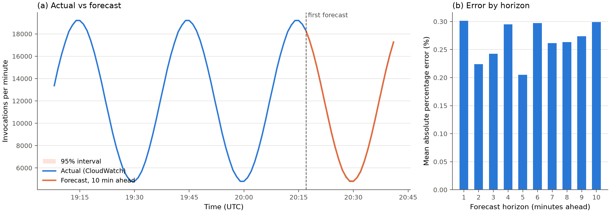

  *Same layout as Run 2026-10-10-1, on the first EC2 run.*
  - What it shows: EC2 traffic is a near-perfect sine (fixed requests per user,
    no network noise), so the forecast lies on top of the actual line, the
    band is too narrow to see, and the error is 0.2-0.3%. This "too easy"
    traffic led to Known issue 11.

  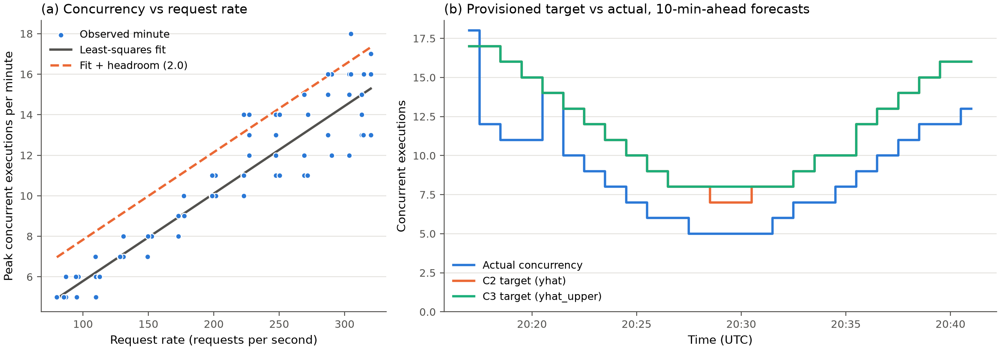

  *Same layout as Run 2026-10-10-2, on EC2 data.*
  - What it shows: from EC2 the line is lower (5-18 environments vs 7-28 from
    the laptop), which is why the laptop calibration was replaced. In (b) C2
    and C3 overlap except at 20:28-20:30, because the band is so narrow. One
    minute (20:17) is under-provisioned, as expected from a 95% headroom.
- Next step: second seasonal dry run with this calibration.

### Run: 2026-10-18-2
- Condition: forecaster benchmark, Prophet vs seasonal naive (offline; no AWS)
- Traffic pattern: seasonal
- Data source: `seasonal_train_run1` (laptop, 2026-10-06-1) and
  `seasonal_c2dry_ec2_run1` (EC2, 2026-10-16-2)
- Duration / sample size: identical walk-forward windows for both models (W = 60,
  H = 10, S = 1): 200 paired forecasts (laptop), 250 (EC2)
- Configuration: seasonal naive = value one 30-minute cycle earlier
  (`src/forecasting/seasonal_naive.py`); its band = 2.5th/97.5th percentiles of
  the window's seasonal differences
- Results:

  | Data | Model | MAE (inv/min) | MAPE | Coverage | Band width |
  |---|---|---|---|---|---|
  | Laptop | Prophet | 250.2 | 1.89% | 94.5% | 1,730 |
  | Laptop | Seasonal naive | 320.3 | 2.50% | 97.5% | 2,244 |
  | EC2 | Prophet | 22.7 | 0.27% | 90.0% | 86 |
  | EC2 | Seasonal naive | 7.3 | 0.09% | 84.0% | 28 |

  - Laptop: Prophet has 22% less error, closer in 61% of forecasts.
  - EC2: seasonal naive has 3.1x less error; Prophet closer in only 18%.
- Notes / anomalies:
  - On noisy traffic (laptop, varying network) Prophet's smooth seasonal fit
    averages out noise that a copy of the last cycle repeats. On EC2 traffic,
    which repeats almost exactly (fixed requests per user, no noise), copying
    the last cycle is near-perfect and Prophet's 3-term Fourier fit carries a
    small systematic error.
  - The gap does not change any capacity decision: 15.4 invocations/min is
    0.26 req/s, about 0.01 environments with the EC2 fit. Forecast accuracy is
    not the limiting factor; the capacity conversion and headroom are.
  - Prophet's value therefore has to come from what seasonal naive lacks:
    calibrated bands (Layer 2), trend and drift handling, regressors and
    retraining (Layers 1 and 4). Recorded as Known issue 11.
  - Outputs: `results/rolling_forecast/<name>_snaive_*`, `<name>_comparison.csv`,
    `_comparison_by_horizon.csv`, `_comparison.png`.
- Figures:

  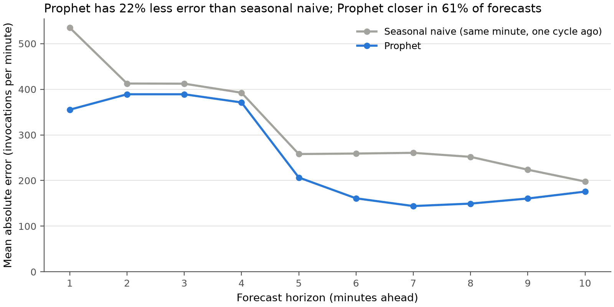
  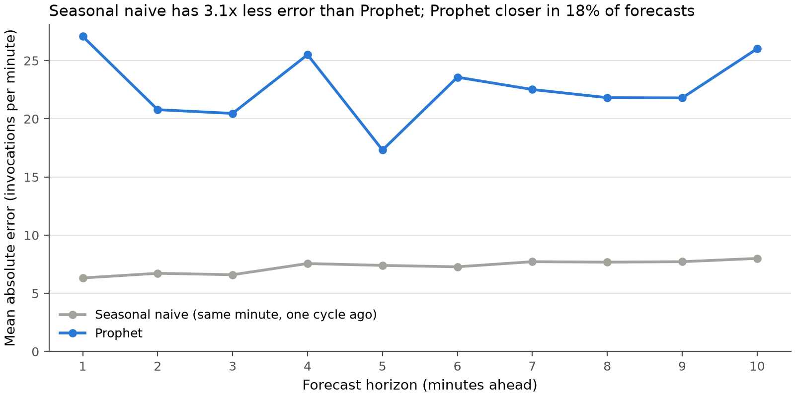

  *Mean absolute error by forecast horizon for Prophet (blue) and seasonal
  naive (grey) on the same walk-forward origins: laptop data (top), EC2 data
  (bottom). Lower is better.*
  - How to read it: seasonal naive is the "copy the last cycle" baseline that
    any forecaster has to beat to be worth using.
  - What it shows: on noisy laptop traffic Prophet is lower at every horizon.
    On noise-free EC2 traffic the baseline is about 3x better (note the y axis
    is only 0-28 there), because a repeating sine is copied exactly.
- Next step: decide how to make the seasonal traffic realistic (seeded noise and
  drift, or a real trace) before the reported runs.

### Run: 2026-10-18-3
- Condition: traffic-realism check, Prophet vs seasonal naive on simulated
  traffic (offline: `TrafficPatternShape.users_at` evaluated directly, no Locust
  or AWS)
- Traffic pattern: seasonal, 95 min, `SEED=42`, 10 req/s per user
- Data source: simulated per-minute invocations (mean users x 600), first and
  last minute dropped
- Configuration: new `traffic_realism` config section: `noise_pct: 10`
  (per-minute multiplicative noise, capped at 3 sigma), `noise_interval_s: 60`,
  `drift_pct: 20` (linear rise in the base level over the run); separate RNG
  stream for noise
- Results:

  | Traffic | Users | Prophet MAE | Seasonal naive MAE | Skill | Coverage (P / SN) |
  |---|---|---|---|---|---|
  | Noiseless | 8-32 | 35 | 0 | n/a (naive exact) | 91% / 100% |
  | Realism on | 8-41 | 1,048 | 1,345 | +0.22 | 92% / 92% |
- Notes / anomalies:
  - Checks passed: realism off reproduces the old seasonal shape exactly; spike
    schedule identical with noise on; same seed gives identical traffic.
  - Noiseless simulated traffic repeats exactly, so seasonal naive has zero
    error, matching the EC2 finding (2026-10-18-2).
  - With realism on, peak load is about 410 req/s (41 users); EC2 has only been
    validated at 200 req/s, so watch throughput against design in the next run.
- Next step: second seasonal dry run on EC2 with realism on; it doubles as the
  out-of-sample test of the EC2 capacity calibration.

### Run: 2026-10-18-4 (ABORTED: stale code)
- Condition: vanilla-prophet, live dry run (intended as the out-of-sample run)
- Traffic pattern: seasonal, 95 min planned
- Data source: EC2 load generator, run `20261018-0742_seasonal_c2_dryrun`
- Duration / sample size: about 5 min (07:42-07:47 UTC), 75,619 requests, 0
  failures; stopped with the instance
- Results: none used
- Notes / anomalies:
  - `git pull` on the instance failed (two untracked controller CSVs from
    2026-10-16-2 would have been overwritten), so the run used commit `879a6cd`:
    no traffic realism, no `--history-start` fix, laptop calibration. Spotted from
    the commit in the start banner. Known issue 13; `run_experiment.sh` now
    refuses to start unless HEAD equals `origin/main`.
  - Its traffic ended about 2.6 min before 2026-10-18-5 started, which left
    that run's environments warm (Known issue 12).
- Next step: move the CSVs aside, pull, rerun (2026-10-18-5).

### Run: 2026-10-18-5
- Condition: vanilla-prophet, live dry run (decisions computed, Provisioned
  Concurrency never changed); out-of-sample test of the EC2 capacity calibration
  and first live run with traffic realism
- Traffic pattern: seasonal (`TrafficPatternShape`, `SEED=42`, `USER_RPS=10`,
  `NOISE_PCT=10`, `NOISE_INTERVAL_S=60`, `DRIFT_PCT=20`; 8-40 users)
- Data source: EC2 load generator (c7i-flex.large, commit `d71b1e0`), run
  `20261018-0750_seasonal_c2_dryrun`; CloudWatch export
  `data/raw/seasonal_c2dry_ec2_run2.csv`, trimmed to 07:51-09:24 in
  `data/processed/`
- Duration / sample size: 95 min, 07:50:02-09:25 UTC, 1,270,623 requests, 0
  failures; 95 controller ticks (64 warming up, 31 decisions, 29 scorable)
- Results:
  - P95 latency: 45 ms (P50 27, P99.9 65, max 3,125 ms)
  - P99 latency: 48 ms
  - Cold start count: 57 inits, all mid-run; 8 user-visible (> 1 s), at 1,803,
    1,984, 2,403 and 3,606 s; 47 returned in under 100 ms. No start-up cold
    starts because the aborted run had warmed the function (Known issue 12)
  - Cost per request: not computed (billed mean 5.9 ms)
  - Load accuracy: 98.4-100.2% of users x 10 req/s per minute (mean 100.0%),
    including 11 minutes at 35-40 users (about 400 req/s); P95 45 ms at every
    load level
  - CloudWatch vs Locust: 1,270,678 vs 1,270,623 invocations (+55)
  - Forecasters, walk-forward (W = 60, H = 10, S = 1, 250 paired forecasts):

    | Model | MAE (inv/min) | MAPE | Coverage | Band width |
    |---|---|---|---|---|
    | Prophet | 1,005.0 | 7.99% | 92.4% | 4,465 |
    | Seasonal naive | 1,266.5 | 9.46% | 92.0% | 5,199 |

    Skill +0.21, Prophet closer in 61% of forecasts (simulation predicted +0.22).
  - Live decisions (target vs actual peak concurrency in each decision's
    window): 7 of 29 under-provisioned (shortfalls 9, 8, 6, 5, 1, 1, 1), 1 exact,
    mean excess 2.07 environments; peak-forecast MAPE 11.3% (worst 33.3%)
  - Calibration out of sample (run-1 fit applied to all 94 minutes): residual
    mean +1.51, 26.6% of minutes above the headroom (designed for 5%), R^2 0.76;
    even a perfect forecast would leave 16 of 94 minutes under-provisioned
- Notes / anomalies:
  - First decision at 08:54, minute 64: the `--history-start` fix works live
    (Known issue 10).
  - The calibration error depends on load. Mean residual by request rate:
    <= 150 req/s +0.14, 150-250 +0.54, 250-320 +2.34, > 320 +3.92 (max 10.3).
    Run 1 only reached 320 req/s, so the fit is extrapolated at the new peaks,
    and concurrency rises faster than linearly there. Billed duration also rose
    (5.1 -> 5.9 ms mean). A refit on this run gives -0.48 + 0.0587 x req/s,
    headroom 3.82 (R^2 0.88). Known issue 7 stays open.
  - The worst shortfalls (9, 8, 6) are at the 08:54-09:02 peak, above 320
    req/s. The largest forecast errors (29-33%, 09:12-09:19) are over-forecasts
    on a noise dip, so they cost money but not cold starts.
  - Outputs: `results/rolling_forecast/seasonal_c2dry_ec2_run2_*` (Prophet,
    seasonal naive, comparison), `results/controller/20261018-0750_*.csv`
    (decision log, plus `_evaluation.csv` and `.png` from `evaluate_decisions.py`).
- Figures:

  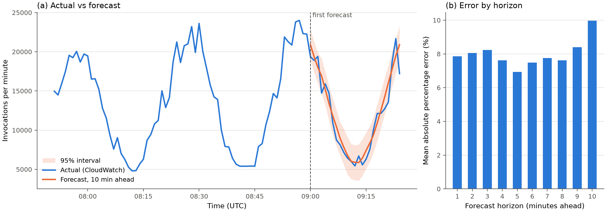

  *Same layout as Run 2026-10-10-1, on this run (noise 10%, drift 20%).*
  - What it shows: the traffic is now irregular minute to minute and each peak
    is higher than the last (drift). Prophet follows the cycle but cannot
    predict the random minute-to-minute noise, so error is about 8%. The
    actual line stays inside the band (92% coverage).

  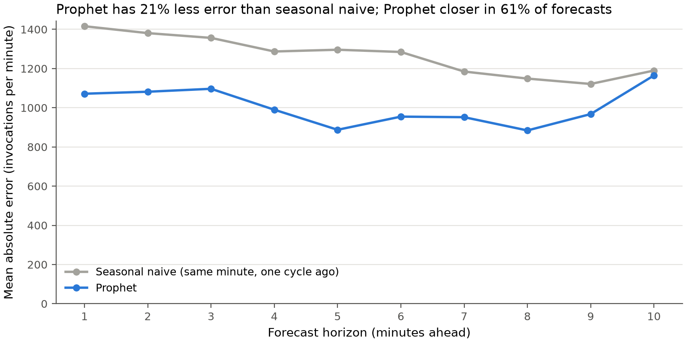

  *Mean absolute error by horizon, Prophet vs seasonal naive.*
  - What it shows: with realistic traffic Prophet is better at every horizon
    (21% less error overall). This reverses the EC2 run 1 result and matches
    the simulation (Run 2026-10-18-3).

  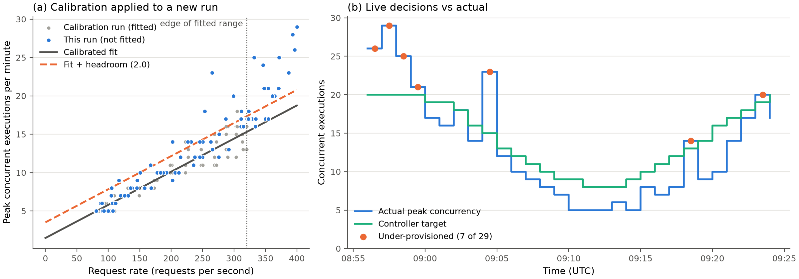

  *(a) The run-1 calibration (line and dashed headroom) applied to this run
  (blue) and to the run it was fitted on (grey); dotted line = highest load in
  the calibration run. (b) The controller's target for each minute against the
  peak concurrency that arrived; orange dots = under-provisioned minutes.
  Produced by `src/evaluation/evaluate_decisions.py`.*
  - How to read it: in (a), blue points above the dashed line are minutes the
    rule would have under-provisioned even with a perfect forecast.
  - What it shows: below about 250 req/s the blue points fall on the grey ones,
    so the calibration transfers. Beyond the fitted range (right of the dotted
    line) they rise well above it. In (b) most shortfalls are at the 08:56-09:00
    peak (above 320 req/s) and at a single burst at 09:04. The target tracks
    the shape well; the error comes from the conversion rule, not the forecast.
- Next step: decide how to calibrate across the full load range (pool runs 1
  and 2 and test on a third, or add a non-linear term), fix the start protocol
  (Known issue 12), then the first `--apply` run.

### Run: 2026-10-29-1
- Condition: capacity-model comparison (offline; no AWS calls)
- Traffic pattern: seasonal
- Data source: `data/processed/seasonal_c2dry_ec2_run1.csv` (2026-10-16-2, 80-320 req/s)
  and `seasonal_c2dry_ec2_run2.csv` (2026-10-18-5, 80-400 req/s), 94 minutes each
- Configuration: `src/evaluation/compare_capacity_models.py`; linear fit of peak
  concurrency on request rate, margin at the 95th percentile, scored with a perfect
  forecast (each minute's actual rate) so only the capacity model is judged
  - additive: fit + residual quantile (the model used so far)
  - multiplicative: fit x quantile of actual / fitted (new `capacity.headroom_mode`)
  - leave-one-run-out (fit on one run, test on the other) and pooled (in-sample)
- Results:

  | Margin | Split | Under-provisioned minutes | Worst shortfall | Excess env-minutes (% of actual) |
  |---|---|---|---|---|
  | Additive | held out run 1 | 0 / 94 (0%) | 0 | 528 (55.0%) |
  | Additive | held out run 2 | 16 / 94 (17.0%) | 8 | 156 (13.2%) |
  | Additive | pooled | 9 / 188 (4.8%) | 5 | 684 (31.9%) |
  | Multiplicative | held out run 1 | 0 / 94 (0%) | 0 | 444 (46.2%) |
  | Multiplicative | held out run 2 | 17 / 94 (18.1%) | 8 | 122 (10.3%) |
  | Multiplicative | pooled | 4 / 188 (2.1%) | 5 | 662 (30.9%) |

  - Chosen: pooled multiplicative, concurrency = 0.17 + 0.0529 x req/s, x 1.26
    (R^2 0.858, 80-400 req/s); `controller.calibration_file` now points at
    `results/capacity_calibration/ec2_pooled_run1_run2.json`
  - Controller replay on run 2 (Prophet `yhat`, C2): under-provisioned decisions
    10/28 with the run-1 calibration -> 5/28 with the pooled one; mean excess
    1.2 -> 2.5 environments. On run 1: 0/28, mean excess 3.7. Both in-sample for
    the pooled fit.
- Notes / anomalies:
  - The two runs agree below about 250 req/s (mean concurrency per 50 req/s band
    within 0.5). At 250-350 req/s run 2 needs about 3 more environments than run 1
    at the same rate.
  - Request rate explains about 86% of concurrency. Billed duration adds nothing
    (correlation with the residual 0.01); the minute-to-minute change in rate adds a
    little (R^2 0.859 -> 0.868; run 2 changes about 34 req/s per minute vs 13 in
    run 1, from the 10% noise). Effective occupancy is about 52-57 ms per request
    (concurrency / rate), against about 5 ms billed.
  - The scatter grows with load (residual standard deviation 0.67 below 150 req/s,
    3.09 above 320), which is why a margin proportional to the fit suits it better
    than a constant one: fewer under-provisioned minutes pooled (2.1% vs 4.8%) and
    less spare capacity in every split.
  - Extrapolation is not fixed by either margin, nor by a quadratic fit (tested:
    17/94 when fitted on run 1 and tested on run 2, because run 1 has no curvature
    to learn). Rule adopted: the calibration data must cover the load range of the
    experiment it is used for. Seasonal runs peak at about 400 req/s; the spiky
    pattern (about 1,000 req/s) will need its own calibration coverage.
  - Outputs: `results/capacity_calibration/ec2_pooled_run1_run2.json`,
    `_comparison.csv`, `_comparison.png`; replay logs
    `results/controller/replay_pooled_run{1,2}.csv`.
- Figure:

  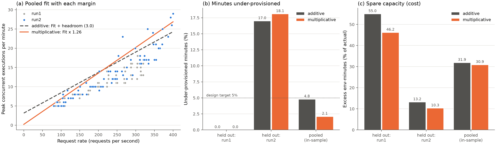

  *(a) Peak concurrency per minute against request rate for both EC2 runs, with the
  pooled fit plus an additive margin (dashed) and a multiplicative margin (solid).
  (b) Share of minutes under-provisioned, and (c) spare capacity as a share of
  actual environment-minutes, for each margin when one run is held out and when
  both are pooled, scored with a perfect forecast.*
  - How to read it: in (b) lower is fewer cold-start minutes; the dotted line is the
    5% the 95th-percentile margin is designed for. In (c) lower is cheaper.
  - What it shows: the multiplicative margin sits lower at low load and higher at
    high load, following the widening scatter. It is cheaper in every split and
    halves under-provisioning when pooled. Holding out run 2 fails for both
    margins (17-18%), because run 1 never reached run 2's peak: the fix is
    calibration data that covers the load range, not a different margin.
- Next step: fix the start protocol (Known issue 12); use the next seasonal run as
  the held-out test of this calibration; then the first `--apply` run.

### Run: 2026-10-29-2 (ABORTED: instance stopped mid-run)
- Condition: vanilla-prophet, live dry run (intended as the held-out test of the
  pooled calibration from 2026-10-29-1)
- Traffic pattern: seasonal, `SEED=7` (new noise, same load range), 95 min planned
- Data source: EC2 load generator, run `20261029-1544_seasonal_c2_dryrun`
- Duration / sample size: about 3.5 min (15:44-15:47:34 UTC), first minute 12,043
  requests and 0 errors; nothing uploaded
- Results: none
- Notes / anomalies:
  - `git pull` on the instance failed again (two untracked controller CSVs from
    2026-10-18 now tracked in the repo), so the run started on commit `d71b1e0`,
    which predates the stale-code check in `run_experiment.sh` (Known issue 13).
  - `loadgen/session.sh stop` was run from the laptop straight after the start,
    which stopped the instance and killed the run. `results` and `stop` are for
    after the run has finished.
- Next step: move the two CSVs aside on the instance, pull to `f6ce563`, rerun with
  `SEED=7`, and leave the instance running until the run uploads to S3.

### Run: 2026-10-29-3 (ABORTED: instance stopped mid-run)
- Condition: vanilla-prophet, live dry run (held-out test, second attempt)
- Traffic pattern: seasonal, `SEED=7`
- Data source: EC2 load generator, run `20261029-1553_seasonal_c2_dryrun`, commit
  `f6ce563` (pull succeeded after moving the two CSVs aside)
- Duration / sample size: about 3 min (15:53 UTC until the instance stopped);
  first minute 12,428 requests, 0 errors; nothing uploaded
- Results: none
- Notes / anomalies: `loadgen/session.sh stop` was again run straight after the
  start (interrupted with Ctrl-C, but the stop request had already been sent).
  The next attempt (`20261029-1558_seasonal_c2_dryrun`) was started after the
  instance came back up. Its start banner warned of uncommitted changes: the `mv`
  was repeated after the pull, which deleted two tracked output CSVs from the
  instance's working tree. Code and config were unchanged, so the run still
  matches `f6ce563`.

### Run: 2026-10-29-4 (ABORTED: stopped by hand)
- Condition: vanilla-prophet, live dry run (held-out test, third attempt)
- Traffic pattern: seasonal, `SEED=7`
- Data source: EC2 load generator, run `20261029-1558_seasonal_c2_dryrun`, commit `f6ce563`
- Duration / sample size: about 4 min (15:58-16:02 UTC); traffic normal (9,994-17,595
  invocations per minute in CloudWatch); nothing uploaded
- Results: none
- Notes / anomalies: stopped by hand after a misunderstanding about the run length
  (95 min is required: about 63 min of warm-up before the first decision, then about
  30 decisions). The instance stayed running.

### Run: 2026-10-29-5
- Condition: vanilla-prophet, live dry run (decisions computed, Provisioned
  Concurrency never changed); held-out test of the pooled multiplicative
  calibration from 2026-10-29-1
- Traffic pattern: seasonal (`TrafficPatternShape`, `SEED=7`, `USER_RPS=10`,
  `NOISE_PCT=10`, `DRIFT_PCT=20`): same shape and load range as runs 1-2, new noise
- Data source: EC2 load generator (c7i-flex.large, commit `f6ce563`), run
  `20261029-1604_seasonal_c2_dryrun`; CloudWatch export
  `data/raw/seasonal_c2dry_ec2_run3.csv`, trimmed to 16:05-17:38 UTC in `data/processed/`
- Duration / sample size: 95 min, 16:04:29-17:39 UTC, 1,275,906 requests, 0
  failures; 29 scored decisions (17:10-17:38)
- Results:
  - P95 latency: 45.1 ms (P50 26.2, P99.9 67.1, max 3,175 ms)
  - P99 latency: 47.5 ms
  - Cold start count: 65 inits, all mid-run; 18 user-visible (> 1 s); 40 returned
    in under 100 ms. No start-up cold starts: the aborted attempts minutes earlier
    (2026-10-29-2 to -4) had left the function warm (Known issue 12)
  - Cost per request: about $2.1e-7 (billed mean 6.5 ms, 128 MB)
  - Load range: 85-366 req/s, concurrency 5-37
  - Live decisions with the pooled calibration, against the old run-1 calibration
    applied to the same forecasts (`yhat_max` from the decision log):

    | Calibration | Under-provisioned decisions | Shortfalls | Mean excess | Env-minutes |
    |---|---|---|---|---|
    | Run 1, additive (old) | 6 / 29 | 1, 1, 2, 2, 4, 5 | 1.93 | 427 |
    | Pooled, multiplicative (new) | 0 / 29 | none | 3.86 | 498 (+17%) |

  - Perfect-forecast check over all 94 minutes: under-provisioned 16/94 (17.0%) with
    the new calibration, 37/94 (39.4%) with the old; excess 11.5% vs 6.6% of
    actual env-minutes. Residual mean +2.63; 26.6% of minutes above the margin
    (designed for 5%)
- Notes / anomalies:
  - Concurrency per request rate rose again from session to session. Mean peak
    concurrency per load band (runs 1 / 2 / 3): up to 150 req/s 5.9 / 6.3 / 7.0;
    150-250 10.5 / 10.9 / 12.3; 250-320 14.0 / 16.1 / 19.2; above 320 n/a / 20.6 / 24.3.
    A calibration fitted on earlier sessions therefore drifts.
  - The outlier minutes coincide with bursts of cold starts: 16:35 (27
    environments, 15 cold starts), 16:40 (30, 3), 16:46 (34, 3), 17:06 (27, 9),
    17:08 (37, 1). A cold start holds an environment for about 3 s instead of about
    50 ms, so requests arriving meanwhile need further new environments: the
    concurrency spike is partly caused by the cold starts themselves. Under
    Provisioned Concurrency these minutes should be smaller, so a calibration
    measured under reactive scaling is conservative at those minutes.
  - The 0/29 result is real but favoured by timing: decisions start after the
    63-minute warm-up, and four of the five outlier minutes fell before 17:10.
  - Figure: `results/controller/20261029-1604_seasonal_c2_dryrun_evaluation.png`.
- Next step: discuss online recalibration (refit the capacity line every minute on
  the same 60-minute window Prophet uses, so session drift is absorbed); fix the
  start protocol (Known issue 12); then the first `--apply` run.

### Run: 2026-10-30-1
- Condition: reactive baseline (C1), traffic only; validation of the start protocol
  (Known issue 12), not one of the nine scenarios
- Traffic pattern: steady (`TrafficPatternShape`, `SEED=42`, `USER_RPS=10`,
  `NOISE_PCT=10`, `DRIFT_PCT=20`)
- Data source: EC2 load generator (c7i-flex.large, commit `349c334`), run
  `20261030-1756_steady_c1_traffic`; alias `prod` moved to freshly published
  version 12 before the run (`lambda_version: "12"`, `start_state: "fresh version
  (cold)"` in the meta file)
- Duration / sample size: 5 min, 17:56:34-18:01:31 UTC, 65,668 requests (about 221
  req/s), 0 failures
- Results:
  - P95 latency: 45.1 ms (P50 26.7, P99.9 72.8, max 3,621 ms)
  - P99 latency: 47.5 ms
  - Cold start count: 23, all within the first 10 s of the run, none afterwards;
    each 3.3-3.6 s (the simulated 3 s init)
  - Cost per request: about $2.2e-7 (billed mean 8.1 ms, 128 MB)
- Notes / anomalies:
  - The start protocol works: every run now starts from no warm environments,
    regardless of earlier traffic (compare 0 start-up cold starts in 2026-10-18-5
    and 2026-10-29-5).
  - Four earlier attempts (versions 8-11) failed in the `published-version-active`
    waiter with AccessDenied on `lambda:GetFunctionConfiguration` for the
    version-qualified ARN: the IAM statement first listed only the function and
    `:prod`. Fixed by allowing `function:sandbox-lambda:*` (commit `349c334`); the
    last failure came about 30 s after the apply, before IAM had propagated.
    Versions 8-11 were published but never received traffic.
  - The instance's `git pull` was again blocked by an untracked controller CSV that
    had since been committed from the laptop (moved to `~/stash`).
- Next step: online recalibration of the capacity model, then the first `--apply` run.

